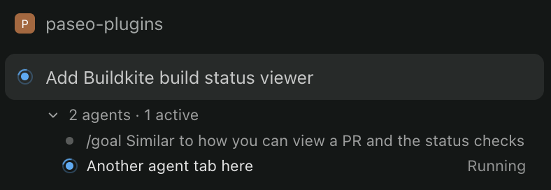

# Sidebar agent tree

Shows each sidebar workspace's agents as a collapsible list with their status.



```bash
paseo plugin add github:conorblencowe/paseo-plugins:sidebar-agent-tree
```

Desktop and web only. It relies on Paseo's internal sidebar markup, so a Paseo update can break it. See [OVERVIEW.md](OVERVIEW.md) for details.
