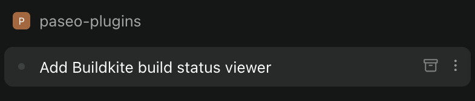

# Sidebar archive button

Adds a one-click archive button to sidebar workspace rows, beside the ⋮ menu.



```bash
paseo plugin add github:conorblencowe/paseo-plugins:sidebar-archive-button
```

Desktop and web only. It relies on Paseo's internal sidebar markup, so a Paseo update can break it. See [OVERVIEW.md](OVERVIEW.md) for details.
